# Rexy 360 — User Guide

**Version 1.0.4-beta** · Rexy 360 is a 360° reframing studio for camera operators: you drive a virtual remote head through 360 footage with real wheels, record the moves, shape them, cut them together and render.

This guide walks through every part of the app. The pictures follow your theme — Rexy 360 has a **Dark** and a **Light** look (top bar → **Theme**).

Rexy 360 runs on **Windows 10 / 11** and **macOS 12 or later** (Apple Silicon and Intel). It works the same on both; on a Mac, use **Cmd** wherever this guide says **Ctrl**.

**Contents** — [The two screens](#the-two-screens) · [The Shoot screen](#the-shoot-screen) · [Library](#library) · [Head — Pan · Tilt · Roll](#head--pan--tilt--roll) · [Lens — Frame · Lens · Zoom](#lens--frame--lens--zoom) · [Time — Speed · Shutter · Trails](#time--speed--shutter--trails) · [Virtual MoCo — recording moves](#virtual-moco--recording-moves) · [Audio](#audio) · [Colour — Grade · LUT](#colour--grade--lut) · [Export — render queue](#export--render-queue) · [Soft Stops](#soft-stops) · [Functions](#functions) · [Gamepad Debug](#gamepad-debug) · [Alt Inputs](#alt-inputs) · [Log](#log) · [The Edit screen](#the-edit-screen) · [Edit timeline](#edit-timeline) · [Edit audio](#edit-audio) · [Keyboard shortcuts](#keyboard-shortcuts) · [Help](#help)

## The two screens

Rexy 360 has two screens, switched at the top left:

- **Shoot** — operate one 360 clip: frame it with the head and lens, record moves (vMoCo), set the time and look, add music, and render a shot.
- **Edit** — put shots together on a timeline with music, and render the whole edit.

Projects save themselves as you work (**Ctrl+S** saves at once — **Cmd+S** on a Mac).

## The Shoot screen

<picture><source media="(prefers-color-scheme: dark)" srcset="guide/dark/shoot_window.png">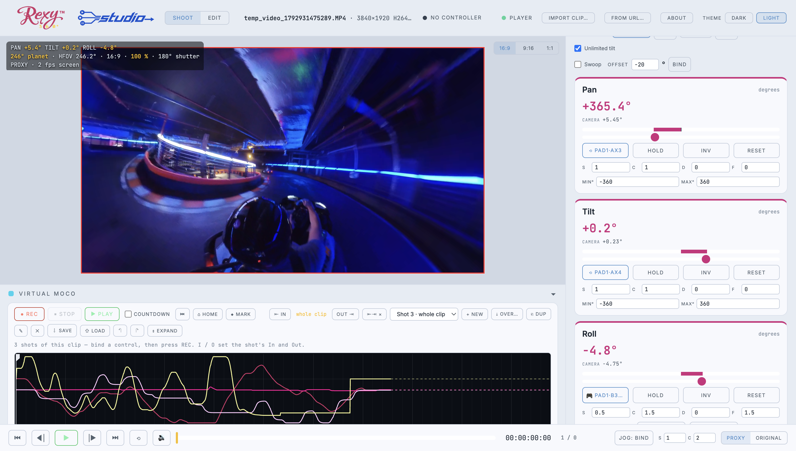</picture>

- **Top bar** — Shoot / Edit, the clip that's open (its size, codec and frame rate), controller and player status, **Import clip…**, **From URL…**, **About**, and **Theme** (Dark / Light). When an update is ready, a button appears here too.
- **Viewer** — what the camera sees. The readout top left shows pan, tilt, roll, the lens and the shutter. The buttons top right (16:9, 9:16, 1:1, 5:4) set the frame shape; the red lines are the frame and safety guides.
- **Left column** — the **Virtual MoCo** timeline and the **Audio** tracks, under the viewer.
- **Right column** — the panels: Library, Head, Lens, Time, Colour, Export, Soft Stops, Functions, Gamepad Debug, Alt Inputs and the Log. Click a panel's title to fold it away; drag the column's left edge to make it wider.
- **Transport** (bottom) — start, frame back, play, frame forward, end, loop and sound; the scrub bar; timecode and frame number; **Jog** (bind a wheel to scrub); and **Proxy / Original** — the light proxy keeps scrubbing smooth, renders always use the original.

### Opening clips

- **Import clip…**, drag a video onto the viewer, or use the Library's **Import…**.
- **From URL…** brings in YouTube, Dropbox, Google Drive or a direct link. Tick **Only part of it** to download a section of a long video. (Only download what you have the rights to use.)
- Stitched **equirectangular** 360 video is the norm. YouTube's cubemap and squashed 16:9 360 downloads are recognised and converted; Insta360 .insv is experimental.

## Library

<picture><source media="(prefers-color-scheme: dark)" srcset="guide/dark/shoot_library.png">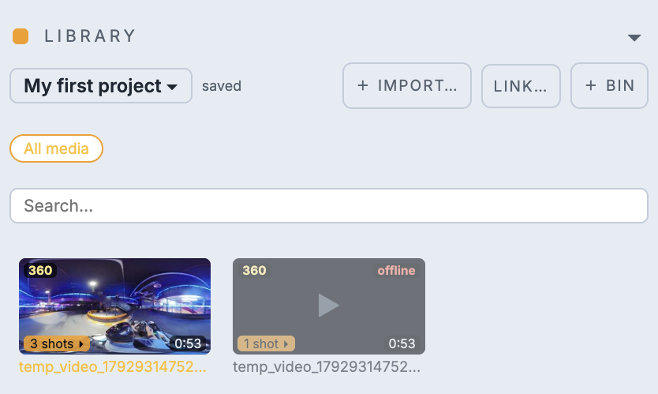</picture>

The Library holds the project's media.

- The **project menu** (click the project name) has **New project…**, **Open project…**, **Save as…** and your recent projects. A new project starts clean.
- **Import…** adds files, **Link…** adds a URL, **+ Bin** makes a folder. **Search** filters.
- Each clip shows how many shots it has. Click the shot count to see the **shots** — each one with a small picture of its moves, live.
- **Double-click** a clip or shot to open it in the Shoot screen. **Drag** shots into the Edit.

## Head — Pan · Tilt · Roll

<picture><source media="(prefers-color-scheme: dark)" srcset="guide/dark/shoot_head.png">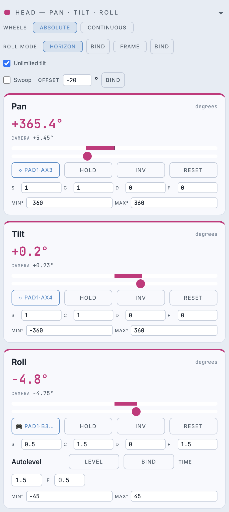</picture>

The virtual remote head.

- **Wheels: Absolute** — the wheel's position is the angle (like a geared head). **Continuous** — the wheel sets a speed (like a fluid head).
- **Roll mode: Horizon** keeps roll level with the horizon; **Frame** rolls the frame itself. Each mode can be bound to a button.
- **Unlimited tilt** lets tilt carry on over the top. **Swoop** pivots the move around a point in the frame (**Offset** sets how far up).
- Each axis has a card:
  - **Bind** — click, then move the wheel, stick or key you want. The button then shows what's bound.
  - **Hold** freezes the axis, **Inv** reverses it, **Reset** returns it to zero.
  - **S** sensitivity, **C** curve, **D** damping, **F** filter.
  - **Min / Max** limit the travel (in Absolute mode they set what the wheel's full turn covers).
- **Autolevel** (on Roll) brings the horizon back to level over **Time** seconds — press **Level** or bind it.

## Lens — Frame · Lens · Zoom

<picture><source media="(prefers-color-scheme: dark)" srcset="guide/dark/shoot_lens.png">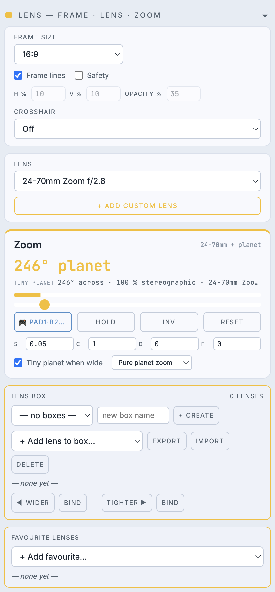</picture>

- **Frame size** — the shape of the shot (16:9, 9:16, 1:1, 2.39:1 …). **Frame lines** and **Safety** guides, with their size (**H % / V %**) and **Opacity**, and the **Crosshair**.
- **Lens** — a library of real zooms and primes; **+ Add custom lens** makes your own.
- **Zoom** — the field of view, bound and tuned like the head axes. **Tiny planet when wide** turns the widest end into a tiny planet (**Pure planet zoom** or **Morph**).
- **Lens box** — a set of lenses to step through with **◀ Wider / Tighter ▶** (each bindable), like swapping primes on set. **Export / Import** shares a box.
- **Favourite lenses** — quick picks.

## Time — Speed · Shutter · Trails

<picture><source media="(prefers-color-scheme: dark)" srcset="guide/dark/shoot_time.png">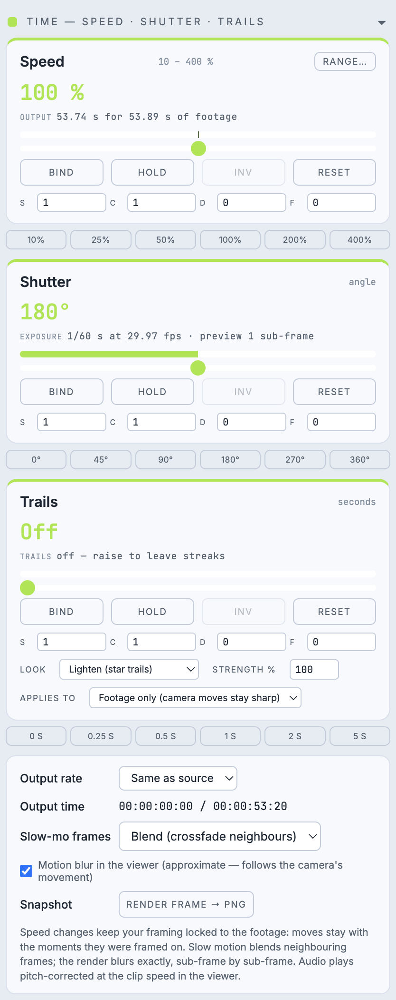</picture>

- **Speed** — 100 % is real time. The buttons jump to common speeds; **Range…** sets how far the control goes (1 % to 10 000 %). Speed is a track you can record, so you can ramp.
- **Shutter** — the shutter angle, for motion blur: 0° is sharp, 180° is the film look, 360° is a full smear.
- **Trails** — light streaks that hang behind movement. **Look** (Lighten, Fade, Average), **Strength**, and whether they apply to the footage only or the camera moves too.
- **Output rate** — the frame rate of renders (same as the source, or 24, 25, 30, 50, 60 …).
- **Slow-mo frames** — when slowed down, new frames are made by **Blend** (crossfading neighbours) or **Optical flow** (tracking the motion).
- **Motion blur in the viewer** shows an approximate blur while you operate; the render blurs exactly.
- **Snapshot — Render frame → PNG** saves a full-resolution still of the current frame.

## Virtual MoCo — recording moves

<picture><source media="(prefers-color-scheme: dark)" srcset="guide/dark/shoot_moco.png">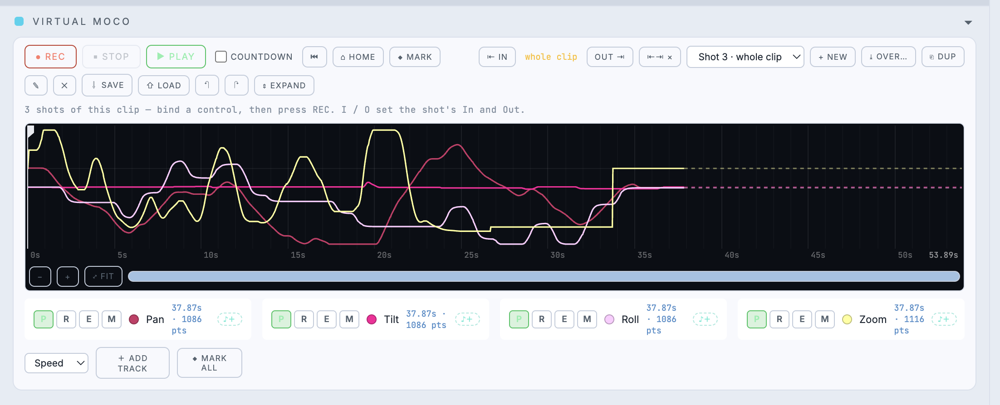</picture>

Every recording is a **shot**: a move over the clip, with its own In and Out, lens and look.

- **● REC** records from the playhead; **■ STOP**; **▶ PLAY** plays the clip with the recorded moves driving the camera. **Countdown** gives you a run-up.
- **⌂ Home** returns to the start; **◆ Mark** drops a mark at the playhead on every track.
- **⇤ In / Out ⇥** (or the **I** and **O** keys) set the shot's In and Out; **⇤⇥ ×** clears them.
- The **shot menu** picks a shot; **+ New** starts another. **⤓ Over…** saves this shot over another (edits using that shot update), **Dup** copies it.
- **✎** (E) reshapes a curve with anchors; **Save / Load** keep moves as `.rxmove` files; **↶ ↷** undo and redo; **Expand** shows one lane per track.
- The **timeline** shows each track's curve. Click to seek, drag to scrub, mouse wheel to zoom (Shift + wheel slides).
- **Each track** (Pan, Tilt, Roll, Zoom, and Speed or others you add):
  - **P** plays it back; **R** records it live. Leave R off to keep a track while you re-record the others (punch in).
  - **E** edits it with anchors; **M** marks the current angle.
  - **♪+** adds an Audio → Move layer.
- **+ Add track** adds a track you drive with its slider and marks; **◆ Mark all** marks every track that already has marks.

## Audio

<picture><source media="(prefers-color-scheme: dark)" srcset="guide/dark/shoot_audio.png">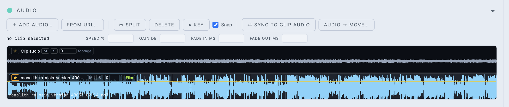</picture>

- **+ Add audio…** or **From URL…** brings in music or sound. The clip's own sound is the first track.
- Each track has **★** (the master music — the song Edit lines shots up to), **M** mute, **S** solo and its volume. **Film / Footage** sets whether it follows the finished film's time or the footage's — music normally follows **Film**.
- Select a piece of audio to set its **speed, gain and fades**. **Split** cuts it at the playhead, **Delete** removes it, **Key** adds a volume keyframe. **Snap** makes audio meet marks and other audio.
- **Sync to clip audio** lines a recording up with the clip's own sound (and fixes drift).
- **Audio → Move…** makes a move **Pulse** with the beat or **Follow** the loudness — as layers you can switch off, edit or bake.

## Colour — Grade · LUT

<picture><source media="(prefers-color-scheme: dark)" srcset="guide/dark/shoot_colour.png">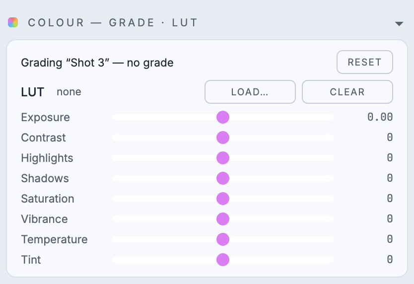</picture>

Grade the shot: **Exposure, Contrast, Highlights, Shadows, Saturation, Vibrance, Temperature, Tint**. **Load…** a `.cube` LUT (with its strength), **Clear** removes it, **Reset** clears the grade. On the Edit screen the same panel grades the whole Edit, on top of each shot's own grade.

## Export — render queue

<picture><source media="(prefers-color-scheme: dark)" srcset="guide/dark/shoot_export.png">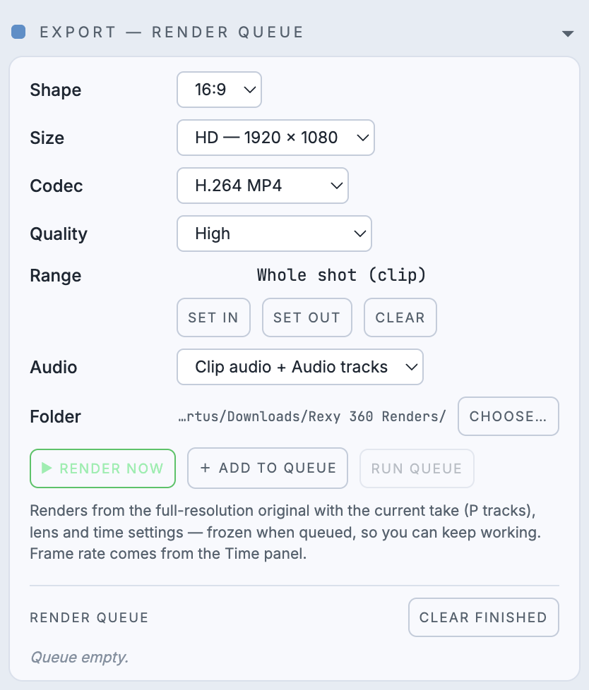</picture>

- **Shape, Size, Codec** (H.264, HEVC or ProRes) and **Quality**.
- **Range** — the whole shot, or **Set In / Set Out** for part of it (**Clear** goes back to the whole).
- **Audio** — the clip's sound, the audio tracks, both, or none. **Folder** — where renders go.
- **▶ Render now**, or **+ Add to queue** and **Run queue** later. Queued renders are frozen as they were, so you can keep working.

Renders always come from the full-resolution original.

## Soft Stops

<picture><source media="(prefers-color-scheme: dark)" srcset="guide/dark/shoot_stops.png">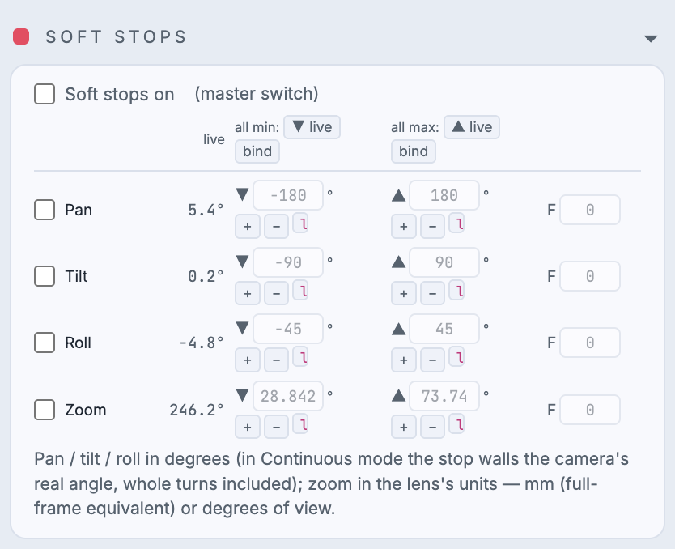</picture>

Limits the camera eases into instead of hitting — like end stops on a real head. Tick the axes you want and **Soft stops on**. Set each **min ▼ / max ▲** by typing, with **+ / −**, or **live** (the current angle; bindable). **F** (feather) is how gently it eases into the limit — 0 is a hard stop.

## Functions

<picture><source media="(prefers-color-scheme: dark)" srcset="guide/dark/shoot_functions.png">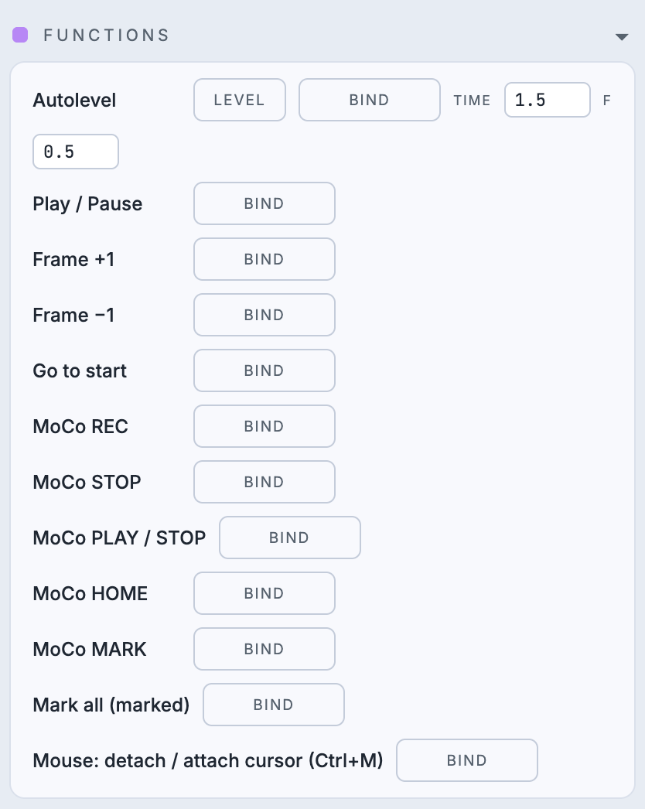</picture>

Bind any button, key or input to an action: **Play / Pause**, **Frame ±1**, **Go to start**, MoCo **REC / STOP / PLAY / HOME / MARK**, **Mark all**, **Autolevel**, and **Mouse: detach / attach cursor**. Click **Bind**, then press what you want; right-click a bind to clear it.

## Gamepad Debug

<picture><source media="(prefers-color-scheme: dark)" srcset="guide/dark/shoot_gpdebug.png">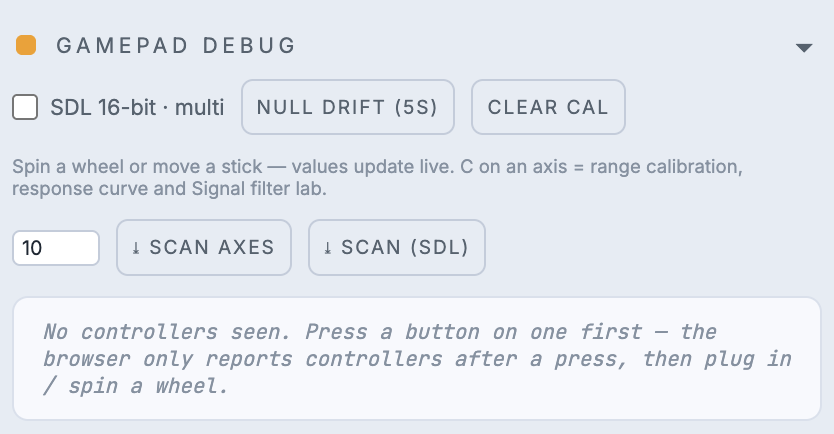</picture>

Shows every controller Rexy 360 can see and what each axis and button is doing — handy for checking a wheel or stick before binding it, and for calibrating.

## Alt Inputs

<picture><source media="(prefers-color-scheme: dark)" srcset="guide/dark/shoot_altinputs.png">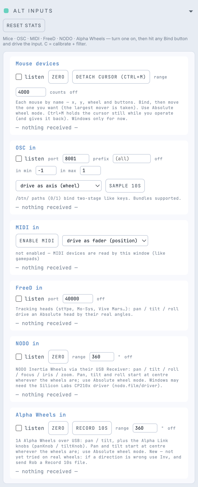</picture>

Other things that can drive the head. Turn one on, then click any **Bind** and move the input. **C** next to an input opens calibration and the Filter Lab.

- **Mouse devices** (Windows only for now) — wheels that only send a mouse signal over USB. Tick **listen** and every mouse shows up by name; bind the one you want. **Range** sets how many counts cover a control; **Zero** re-centres. **Detach cursor (Ctrl+M)** holds the pointer still while the wheels drive — Ctrl+M again, or switching to another app, gives it back.
- **OSC in** — a port and an optional address prefix; drive as an axis (wheel) or a fader.
- **MIDI in** — **Enable MIDI**, then any controller's knobs and faders.
- **FreeD in** — tracking heads (stYpe, Mo-Sys, Vive Mars…) drive the head by their real angles.
- **NODO in** — NODO Inertia Wheels through their USB receiver. (Windows may need the Silicon Labs CP210x driver: nodo.film/driver.)
- **Alpha Wheels in** — 1A Alpha Wheels over USB: the **pan** and **tilt** wheels, plus the Alpha Link knobs (**panKnob** and **tiltKnob**). Plug the wheels in and tick **listen** — Rexy 360 finds them by itself and switches them to their serial mode while it reads them; unticking (or closing Rexy 360) puts them back in the mode you had, so they work as before in other apps. Use **Absolute** wheel mode. The wheels start at centre wherever they are; **Zero** re-centres, and **range** sets how many degrees one turn of a wheel covers (at 360°, one turn of the wheel takes the camera all the way round). If a direction is the wrong way round, use **Inv** on that axis. **Record 10s** saves a short file of what the wheels sent — if anything isn't right, send it to Rob. (Quit AW Translator first — only one app can use the wheels' port at a time.)

## Log

<picture><source media="(prefers-color-scheme: dark)" srcset="guide/dark/shoot_log.png">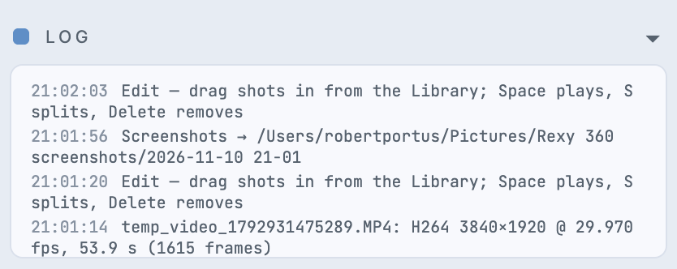</picture>

What Rexy 360 has just done — imports, renders, warnings. The newest line is at the top.

## The Edit screen

<picture><source media="(prefers-color-scheme: dark)" srcset="guide/dark/edit_window.png">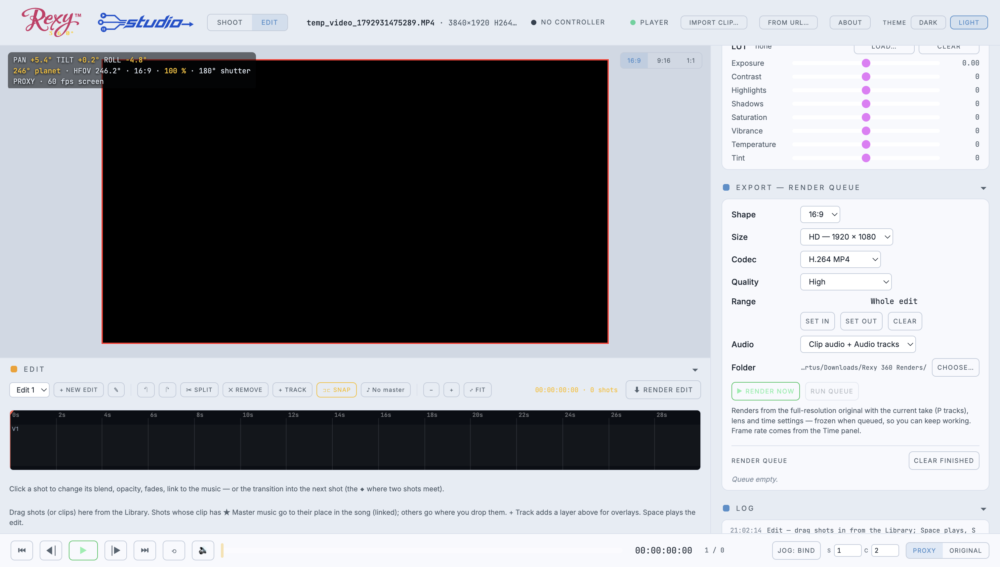</picture>

Switch to **Edit** (top left). The viewer plays the edit; under it are the **Edit** timeline and the Edit's **Audio**; the right column keeps the **Library**, **Colour** (the whole Edit's grade), **Export** and the **Log**.

## Edit timeline

<picture><source media="(prefers-color-scheme: dark)" srcset="guide/dark/edit_edit.png">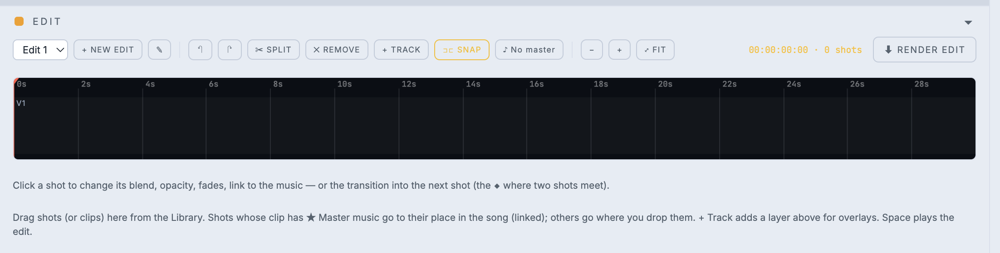</picture>

- The **edit menu** switches between edits in the project; **+ New edit** starts another; **✎** renames it.
- **Drag shots in** from the Library.
  - A shot whose clip has ★ master music goes to its place in the song — it's **linked**.
  - The first linked shot in an empty Edit starts the Edit.
  - Others go where you drop them.
- **Split** (S) cuts at the playhead; **Remove** (Delete) takes out the selected shot. When no shot uses the master music any more, the Edit lets go of it.
- **+ Track** adds a layer above for overlays — with blend modes, opacity, fades and opacity keyframes (**K**).
- **Snap** — on, shots you drop or drag meet their neighbours (no gaps, no overlaps); off, they go exactly where you put them.
- **♪** shows the Edit's master music; click to change it.
- **−, + and Fit** zoom the timeline (or use the mouse wheel; Shift + wheel slides).
- **Click a shot** to see its details under the timeline:
  - **Linked** — click to unlink it and drag it anywhere. Right-click → **Link** puts it back on the music.
  - **Its music** — brings the shot's own music onto the Edit.
  - The **◆ transition** where two shots meet: a dissolve or a dip.
- **⬇ Render edit** renders the whole edit with the Export settings. **I / O** (or Export's Set In / Set Out) render part of it.
- **Ctrl+Z / Ctrl+Y** undo and redo.

## Edit audio

<picture><source media="(prefers-color-scheme: dark)" srcset="guide/dark/edit_audio.png">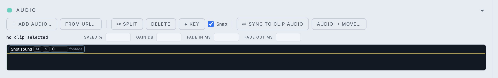</picture>

The Edit has its own audio tracks, on Edit time. **Shot sound** is each shot's own sound. **★ Master** — the song the linked shots line up to — runs along the bottom. Add more music or effects with **+ Add audio…**, exactly as on the Shoot screen.

## Keyboard shortcuts

| Key | Shoot screen | Edit screen |
|---|---|---|
| Space | Play / pause (MoCo play when moves are recorded) | Play / pause the edit |
| , and . | One frame back / forward (Shift: 10) | One frame back / forward (Shift: 10) |
| Home / End | Start / end of the clip | Start / end of the edit |
| I / O | The shot's In / Out | The render's In / Out |
| S | — | Split at the playhead |
| K | — | Opacity keyframe on the selected overlay |
| Delete | — | Remove the selected shot |
| Ctrl+Z / Ctrl+Y | — | Undo / redo |
| Ctrl+S | Save the project now | Save the project now |
| Ctrl+M | Detach / attach the cursor (mouse-device wheels, Windows) | |
| Ctrl+Shift+P | Screenshots of the whole app, dark and light, into Pictures | |

On a Mac, Ctrl is **Cmd** (Cmd+S, Cmd+Z, Cmd+Shift+P …). Keys you bind in the panels take priority over these.

## Help

- **About** shows the version, licence and **Check for updates**. Rexy 360 also checks when it starts.
  - **Windows** — the update downloads in the background and the top bar offers **Restart to update** (your project is saved first).
  - **Mac** — the top bar shows **⬇ Download**, which opens the download page; install the new .dmg over the old app.
- **Mac, first launch** — the app isn't code-signed yet, so the first time **right-click Rexy 360 → Open → Open**. The first time it reads a gamepad or Rexy Wheels, macOS asks for **Input Monitoring** — allow it, then restart Rexy 360.
- Questions, bugs and ideas: **rob@realprogear.com**.

© 2026 Real Pro Gear Ltd. Designed by Robert Portazier.
